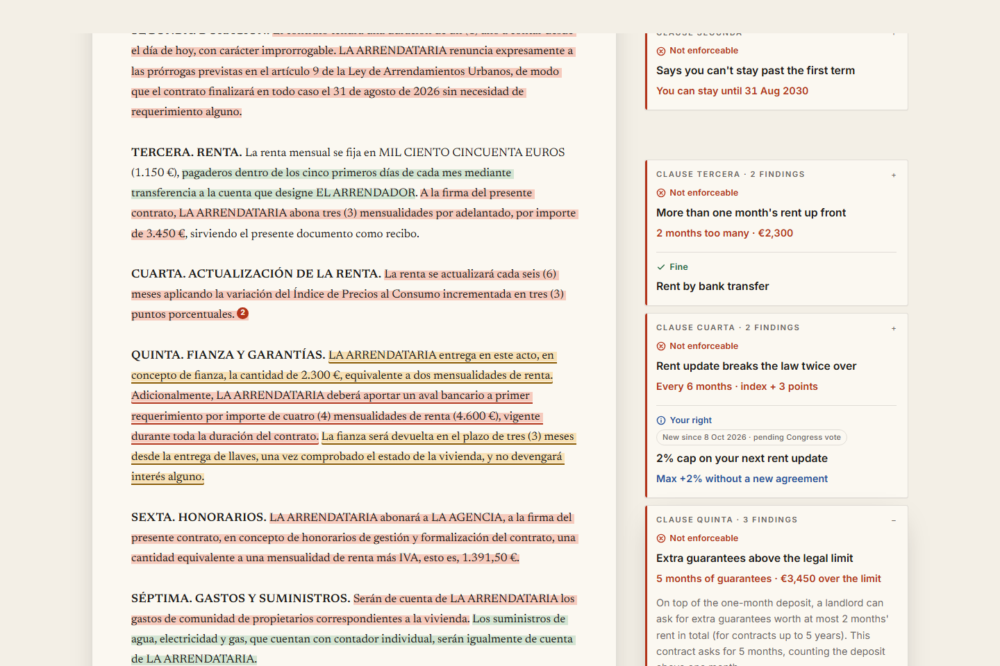

# Fair Lease

**Is your rental contract legal?** Paste a Madrid rental contract, or upload the PDF, and Fair Lease marks every clause Spanish law doesn't allow, on your own text, with the exact article, a plain-English explanation and what to ask for instead.

Made for people renting a home in Madrid, especially young people and students from abroad who don't read Spanish legal language.

**Try it now: [fair-lease.vercel.app](https://fair-lease.vercel.app)**. No account. Tap one of the three sample contracts and its problem clauses light up; click a highlight to see the article and what to ask for instead.



## How it works

1. **Your browser removes personal data** (ID numbers, IBANs, phone numbers, emails) before anything is sent. An uploaded PDF is read in the browser too ([pdf.js](https://mozilla.github.io/pdf.js/), loaded only when you pick a file): its text lands in the paste box and takes exactly the same path, so the file never leaves your device. Scanned PDFs with no text layer get a clear message; there is no OCR.
2. **Claude reads and quotes.** One server route asks Claude for the contract's facts (signing date, rent, landlord type…) and its clauses, each with a literal quote and a few plain facts. Structured output, no verdicts.
3. **The code checks every quote** is literally in your contract. Anything it can't find is dropped and counted.
4. **The signing date picks the law.** Spain's tenancy law changed in March 2019, May 2023 and again on 8 October 2026 (that last reform is still pending a vote in Congress).
5. **Fixed rules decide.** 18 rules written from the BOE turn those facts into verdicts, euro amounts, the article and what to ask for instead. See [docs/rules.md](docs/rules.md).

The three samples on the start screen skip step 2: their extraction is saved in the repo. Steps 3-5 still run for real every time, so the samples open instantly, work without an API key, and never fake the part that decides.

## Run it

Requires Node 22.20+.

```bash
npm install
npm run dev            # http://localhost:3000
```

The samples and the tests need no key. For live checks of a pasted contract, create `.env.local` from [`.env.example`](.env.example) with your own `ANTHROPIC_API_KEY`.

```bash
npm test               # unit tests: rules vs. expected results, quotes, law versions, money, letter, live route
npm run build
npm run check:ui       # Playwright checks at 1440 px and 390 px (runs `next start` on port 3100)
```

## Cost and speed (measured 24 Oct 2026)

| What | Model | Tokens in / out | Time | Cost |
|---|---|---|---|---|
| Live check, traps contract | Claude Sonnet 5.5 | 7,351 / 3,118 | 14 s | ≈ $0.05 |
| Live check, Oct 2026 contract | Claude Sonnet 5.5 | 6,349 / 1,875 | 10 s | ≈ $0.03 |
| Recording the three samples (once) | Claude Opus 5.5 | 20,872 / 7,950 | 15–22 s each | ≈ $0.24 total |

The public site allows 25 live checks a day (best effort, in memory). The hard cap is a spend limit on the API key.

In both live checks, Claude Sonnet 5.5 gave the same not-enforceable and worth-checking verdicts as the hand-made expected results, with every quote found in the text.

## Model alone vs Fair Lease

Is this just asking the AI? I measured it on 24 Oct 2026: the same model (Sonnet 5.5) on the three sample contracts, 41 hand-labelled clauses, three runs each. "Alone" is the plain question ("revisa este contrato de alquiler español firmado el ... y dime qué cláusulas no son exigibles según la LAU, con el artículo") with no rules and no quote check.

| | Fair Lease | Sonnet 5.5 alone |
|---|---|---|
| Verdict matches the expected one (of 41 clauses) | 41 | 29.3 (29-30) |
| Not-enforceable clauses found (of 15) | 15 | 9.7 (9-10) |
| Fine clauses called illegal or sent to review (of 24) | 0 | 4.3 |
| Oct 2026 contract, clauses right (of 8) | 8 | 3.3 (3-4) |
| Right version of the law (of 3 contracts) | 3 | 1.3 (1-2) |
| Euro figures right (of 4) | 4 | 1.3 (1-2) |
| Invented articles / quotes not in the contract | 0 / 0 | 0 / 0 |
| Cost per contract | $0.040 | $0.044 |

The model alone is a decent first reader: it flags 14 of the 17 problem clauses and never made up a quote or an article. What it lacks is the date of the law (it applied the May 2023 text to the October 2026 contract in every run), steady verdicts, and the arithmetic (it gave the €7,141.50 total in none of three runs). The first round found one miss in Fair Lease, a false alarm on the clean contract: the model ticked a stray signal on the landlord's need clause and rule FL-06 let it decide. I changed FL-06 to read the quote against article 9.3 and re-ran the rules on the same stored extractions, which gives 41 of 41, and one fresh live pass on the clean contract came back clean. That fix was made after seeing the failure, and the expected results and the rules share an author, so read the 41 as "the pipeline reproduces our hand-checked reading", not as a blind score. Method, limits and every raw answer: [eval/README.md](eval/README.md). To recompute the table without any API call: `npm run eval:score`.

## Stack

Next.js 16.4 (App Router, TypeScript) with Tailwind CSS 4, the Anthropic TypeScript SDK and zod. Tested with Vitest and Playwright. Fonts: Newsreader and Inter.

## Built with the Devpost Learn Skill Pack

The plan lives in [`devpost/`](devpost): [scope](devpost/scope.md), [product requirements](devpost/prd.md), [technical spec](devpost/spec.md) and the [build checklist](devpost/checklist.md), made with the [Build With AI: Basics](https://github.com/challengepost/learn-ai-basics) skill pack. `skills-lock.json` records the pack's source.

**Prepared before the project folder was created (no code):** legal research notes on the LAU (checked against the BOE), and three fictional sample contracts with their expected results. These were prepared with AI help.

## License

[MIT](LICENSE). The skill pack used for planning is MIT-licensed by its authors.

## Not legal advice

Fair Lease is an information tool. It checks a contract against a small set of rules and shows the exact article. For a decision that matters, talk to a tenants' union, your city's consumer office or a lawyer.
